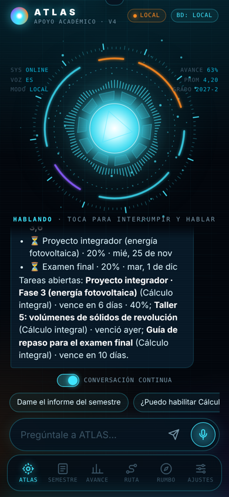
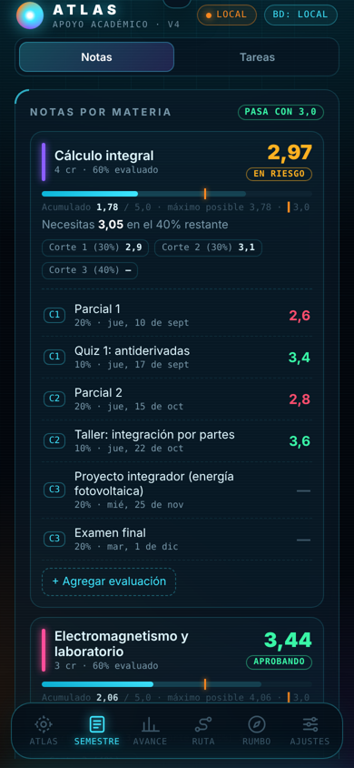
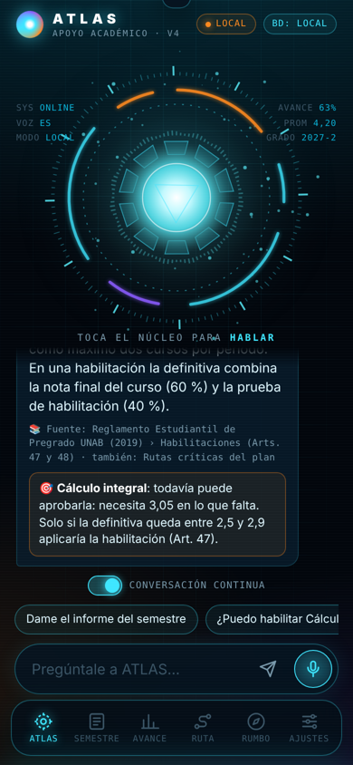
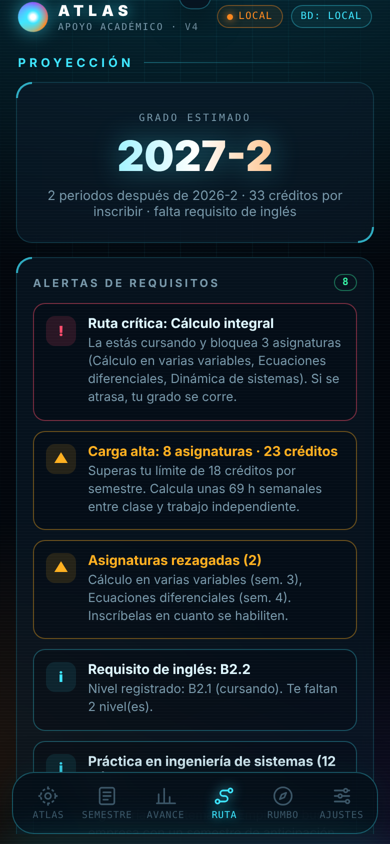
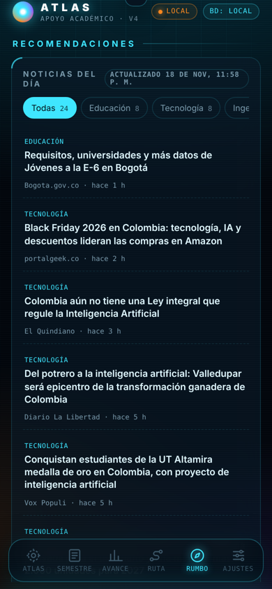

# ATLAS · Chatbot de apoyo académico con n8n

> **Trabajo final · Ciencia de Datos · Tema 2** · Ingeniería de Sistemas, Universidad Autónoma de Bucaramanga (UNAB)
> Autor: José Elías Cruz

[](https://elias2111.github.io/atlas-chatbot-academico/)
[](https://github.com/elias2111/atlas-chatbot-academico/actions/workflows/scraper-noticias.yml)

**ATLAS** es un modelo en **n8n** que apoya al estudiante de Ingeniería de Sistemas en la **matrícula**, el **estado académico actual** y su **proyección**, con **requisitos** y **recomendaciones** para tener éxito en el programa: **investigación, autoaprendizaje y educación de precisión**. Se usa por voz, al estilo de un mayordomo de IA, desde una app móvil.

**▶ App:** https://elias2111.github.io/atlas-chatbot-academico/ (Android: Chrome → *Instalar app* · iPhone: Safari → *Compartir* → *Agregar a pantalla de inicio*)

| Asistente de voz | Notas del semestre | Tareas | Reglamento (RAG) | Ruta y requisitos | Recomendaciones y noticias |
|:-:|:-:|:-:|:-:|:-:|:-:|
|  |  |  |  |  |  |

## Componentes

| Componente requerido | Implementación en ATLAS | Documentación |
|---|---|---|
| **Base de datos PostgreSQL** | Plan de 151 créditos, prerrequisitos, matrícula, notas por evaluación, tareas y noticias; vistas y funciones que calculan nota actual, nota necesaria y estado | [BASE_DE_DATOS.md](docs/BASE_DE_DATOS.md) · [schema.sql](backend/schema.sql) |
| **n8n con agente** | Agente con `gpt-4o-mini`, memoria en PostgreSQL, herramientas RAG y MCP, y **guardrails** de entrada y salida | [WORKFLOWS_N8N.md](docs/WORKFLOWS_N8N.md) |
| **RAG** | Reglamento UNAB, plan de estudios y guía de éxito académico → fragmentos 1000/150 → `text-embedding-3-small` → pgvector. Evaluado: precisión@1 83 %, recall@3 100 % | [RAG.md](docs/RAG.md) · [evidencia](rag/EVIDENCIA_RECUPERACION.md) |
| **Servidor MCP** | 6 herramientas (estado académico, notas, tareas, prerrequisitos, noticias, reglamento) en n8n y en un servidor Python probado 7/7 | [MCP_Y_WEBHOOK.md](docs/MCP_Y_WEBHOOK.md) · [evidencia](mcp-server/EVIDENCIA_PRUEBAS.md) |
| **Webhook** | `POST /webhook/atlas-chat`, `GET /webhook/atlas-noticias`; pruebas con curl y Postman | [tests/](tests) |
| **Scraper de noticias** | GitHub Actions dos veces al día (y flujo de n8n equivalente): educación, tecnología e ingeniería de sistemas, con fuente y fecha | [SCRAPER.md](docs/SCRAPER.md) · [ejecuciones](https://github.com/elias2111/atlas-chatbot-academico/actions/workflows/scraper-noticias.yml) |
| **App móvil Android** | PWA instalable (Android e iPhone): voz, notas, tareas, proyección, alertas, recomendaciones y noticias, conectada al webhook | [ANDROID.md](docs/ANDROID.md) · [MANUAL_USUARIO.md](docs/MANUAL_USUARIO.md) |

## Arquitectura

```mermaid
flowchart LR
  APP["📱 App ATLAS<br/>PWA Android/iPhone<br/>voz · guardrails"] -->|"POST /atlas-chat"| WH["n8n Webhook"]
  WH --> GI["🛡️ Guardrail<br/>entrada"] --> AG["🤖 Agente<br/>gpt-4o-mini + memoria"]
  AG -->|reglamento_academico| RAG[("🔎 RAG<br/>pgvector")]
  AG -->|MCP Client| MCP["🔌 Servidor MCP<br/>6 herramientas"]
  MCP -->|SQL parametrizado| PG[("🐘 PostgreSQL<br/>Supabase")]
  AG --> GO["🛡️ Guardrail<br/>salida"] -->|"{ reply }"| APP
  SCR["📰 Scraper<br/>GitHub Actions / n8n"] -->|noticias| PG
  SCR -->|data/noticias.json| APP
  APP -->|"REST: notas y tareas"| PG
  ING["📄 Ingesta RAG<br/>1000/150 · embeddings"] --> RAG
```



Diagrama completo, secuencia de una consulta y **justificación de cada decisión de diseño**: [docs/ARQUITECTURA.md](docs/ARQUITECTURA.md).

## Qué responde ATLAS

| Pregunta (por voz o texto) | Respuesta | Fuente de los datos |
|---|---|---|
| "Dame el informe del semestre" | Promedio parcial, materias en riesgo, tareas vencidas, próximas entregas | `v_notas_semestre`, `v_tareas` |
| "¿Cómo voy en Cálculo integral?" | "En riesgo: llevas 2,97 con el 60 % evaluado; necesitas 3,05 en el 40 % que falta" | `fn_notas_semestre` (MCP) |
| "¿Puedo habilitar Cálculo integral?" | Arts. 47 y 48 + cálculo personal de la nota de habilitación | RAG + base de datos |
| "¿Qué tareas tengo vencidas?" | Lista con fecha y avance | `fn_tareas` (MCP) |
| "¿Cuándo me gradúo?" / "¿Qué inscribo el próximo semestre?" | Proyección semestre a semestre respetando prerrequisitos y el límite de créditos | plan + expediente |
| "¿Qué requisitos tengo pendientes?" | Ruta crítica, rezago, carga, inglés B2, Saber Pro, PGA ≥ 3,20, práctica | reglamento + expediente |
| "Dame recomendaciones" | Educación de precisión, investigación y autoaprendizaje, con fuentes | guía de éxito académico (RAG) |
| "Noticias de tecnología de hoy" | Titulares con fuente y fecha | scraper |
| "Saqué 3,5 en el examen final de Electromagnetismo" | Registra la nota y dice si aprobó (definitiva sin aproximar, Art. 39) | escribe en `evaluacion` |

## Estructura del repositorio

```
├── index.html                 # app completa (PWA): voz, motor local, RAG BM25, guardrails, notas, tareas, noticias
├── manifest.json · sw.js      # instalación y modo sin conexión
├── data/
│   ├── noticias.json          # lo publica el scraper (GitHub Actions)
│   └── rag_index.json         # índice RAG para la app (35 fragmentos)
├── backend/
│   ├── schema.sql             # PostgreSQL: tablas, datos, vistas, funciones, permisos
│   ├── consultas_demo.sql     # consultas para la sustentación
│   ├── n8n_atlas_chat.json            # agente + LLM + memoria + RAG + MCP + guardrails
│   ├── n8n_atlas_mcp_server.json      # MCP Server Trigger con 6 herramientas
│   ├── n8n_atlas_scraper_noticias.json
│   └── n8n_atlas_ingesta_rag.json
├── rag/
│   ├── docs/                  # corpus: reglamento UNAB, plan de estudios, guía de éxito académico
│   ├── rag_local.py           # fragmentación 1000/150, índice y evaluación
│   └── EVIDENCIA_RECUPERACION.md
├── mcp-server/
│   ├── atlas_mcp_server.py    # servidor MCP (stdio + HTTP), solo biblioteca estándar
│   ├── probar_mcp.py          # cliente de prueba
│   └── EVIDENCIA_PRUEBAS.md
├── scraper/scraper_noticias.py
├── .github/workflows/scraper-noticias.yml
├── tests/                     # probar_webhook.sh (curl) · ATLAS.postman_collection.json
└── docs/                      # arquitectura, RAG, BD, n8n, MCP, scraper, Android, manual, prompts, guía de evidencias
```

## Instalación

1. **App**: ya está publicada. Para tu propia copia, haz un *fork* y activa GitHub Pages (Settings → Pages → `main` / root).
2. **Base de datos**: crea un proyecto en Supabase y ejecuta `backend/schema.sql` en el SQL Editor ([detalle](docs/BASE_DE_DATOS.md)).
3. **n8n**: importa los 4 JSON de `backend/`, crea las credenciales de Postgres y OpenAI, sube los documentos del RAG y activa los flujos ([detalle](docs/WORKFLOWS_N8N.md)).
4. **Conecta la app**: en Ajustes pega la URL del webhook de n8n (Conexión n8n) y la URL y *anon key* de Supabase (Base de datos académica).
5. **Scraper**: ya corre en GitHub Actions. Si agregas los secretos `SUPABASE_URL` y `SUPABASE_KEY`, también guarda las noticias en PostgreSQL.
6. **Pruebas**: `bash tests/probar_webhook.sh`, `python mcp-server/probar_mcp.py`, `python rag/rag_local.py eval`.

La guía paso a paso, con la lista de capturas por criterio de la rúbrica, está en **[docs/GUIA_DESPLIEGUE_Y_EVIDENCIAS.md](docs/GUIA_DESPLIEGUE_Y_EVIDENCIAS.md)**.

## Pertinencia pedagógica

- **Educación de precisión** (Yang, 2021; Luan y Tsai, 2021):
  - *Diagnóstico*: notas por área y por corte.
  - *Predicción*: nota necesaria en lo que falta y proyección de grado.
  - *Intervención*: plan semanal de horas ponderado por ruta crítica y riesgo.
  - *Prevención*: alertas de requisitos, tareas vencidas y PGA.
- **Autoaprendizaje**: práctica de recuperación y práctica distribuida, las dos técnicas de mayor utilidad según Dunlosky et al. (2013); pruebas de práctica (Roediger y Karpicke, 2006).
- **Investigación**: semilleros, radar bibliográfico, publicación del proyecto de grado y noticias del día como insumo.
- **Reglamento UNAB aplicado**:
  - definitiva sin aproximar (Art. 39);
  - habilitación con nota ≥ 2,5, ponderada 60/40 (Arts. 47 y 48);
  - estado condicional y prueba académica (Arts. 10–12);
  - requisitos de grado: PGA ≥ 3,20, inglés B2 y Saber Pro (Art. 67).
- Los prompts usados y ejemplos de respuestas están en **[docs/PROMPTS.md](docs/PROMPTS.md)**.

## Notas

- **Plan de estudios**: las asignaturas y créditos son los del plan oficial. Los prerrequisitos son una propuesta, porque el plan no los publica; se ajustan en la constante `PLAN` de `index.html` y en `backend/schema.sql`.
- **Datos de ejemplo**: las notas del estudiante de ejemplo son inventadas; las tareas corresponden a proyectos reales del semestre 2026-2.
- **Privacidad**: el expediente y las claves se guardan en el dispositivo (`localStorage`), salvo que se conecte Supabase. En producción, la *anon key* debe acompañarse de Supabase Auth y políticas RLS por estudiante.
