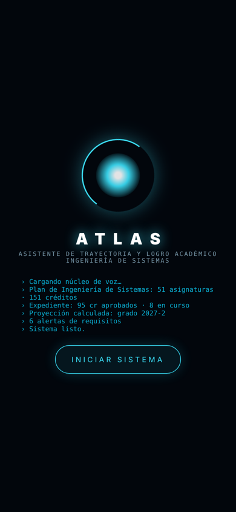
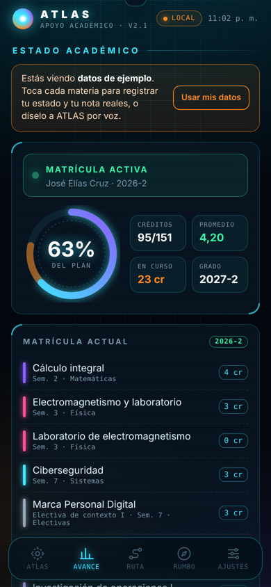
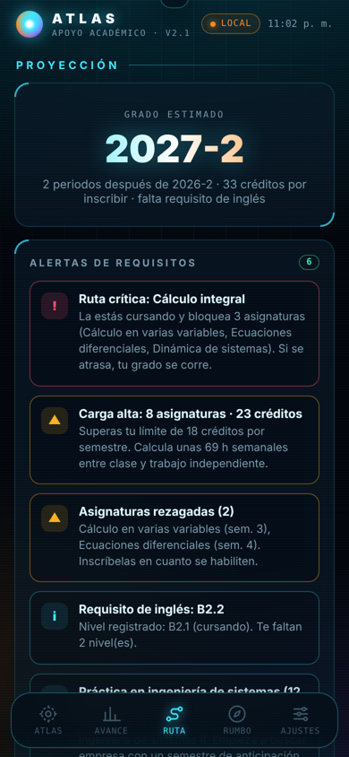
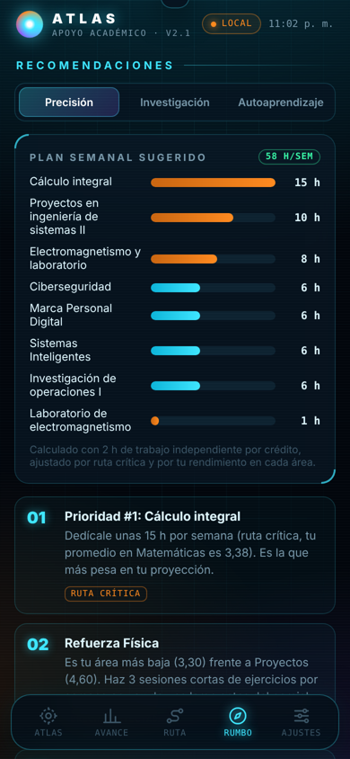
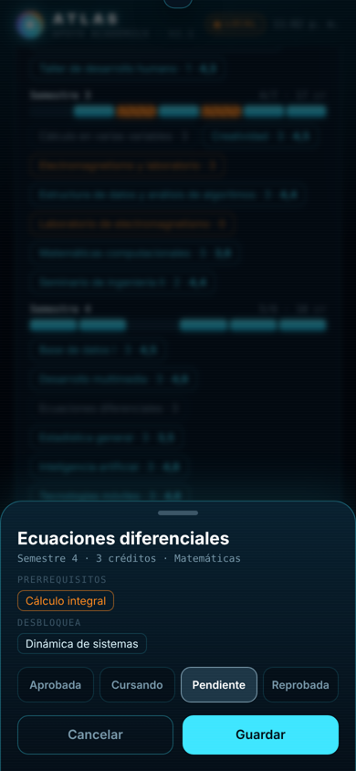

# ATLAS · Chatbot de apoyo académico con n8n

> **Trabajo final de Ciencia de Datos, Tema 2** · Ingeniería de Sistemas
> Autor: José Elías Cruz

**▶ App en vivo:** https://elias2111.github.io/atlas-chatbot-academico/
(ábrela en Safari desde el iPhone y toca **Compartir → Agregar a pantalla de inicio**)

ATLAS es un asistente académico **por voz**, al estilo de un mayordomo de IA, que apoya al estudiante de Ingeniería de Sistemas en:

1. **Estado de matrícula y avance del plan de estudios**: los 9 semestres y 151 créditos del plan oficial.
2. **Proyección de semestres restantes y alertas de requisitos pendientes**: ruta crítica, rezago, carga, inglés y práctica.
3. **Recomendaciones personalizadas para el éxito académico**: educación de precisión, investigación y autoaprendizaje.
4. **Base conceptual**: chatbot institucional con **arquitectura RAG, n8n, PostgreSQL y app móvil**.

| Arranque | Asistente de voz | Avance | Ruta | Recomendaciones | Editar materia |
|:-:|:-:|:-:|:-:|:-:|:-:|
|  |  |  |  |  |  |

---

## Arquitectura

```
 ┌──────────────────────────┐      POST {message, context}      ┌───────────────────────────────┐
 │  App móvil (PWA · iPhone) │ ────────────────────────────────▶ │ n8n · Webhook /atlas-chat     │
 │  • Voz: Web Speech API    │                                   │   ├─ PostgreSQL (expediente)  │
 │  • Expediente editable    │ ◀──────────────────────────────── │   ├─ Agente IA + memoria      │
 │  • Motor local offline    │            {reply}                │   └─ RAG: reglamento (pgvector)│
 └──────────────────────────┘                                   └───────────────────────────────┘
          │  sin n8n
          └──▶ IA directa (OpenAI) ──▶ o motor local de intenciones (sin internet)
```

La app tiene **tres niveles de inteligencia** y siempre usa el más alto disponible; si uno falla, pasa al siguiente:

| Nivel | Requiere | Qué hace |
|---|---|---|
| 1. Motor local | Nada (funciona sin internet) | Entiende preguntas sobre matrícula, avance, grado, requisitos, materias, promedio y recomendaciones, y comandos que actualizan el expediente |
| 2. IA directa | API key de OpenAI (Ajustes) | Preguntas abiertas respondidas con todo el expediente como contexto |
| 3. n8n + RAG | Flujo de `backend/` activo | Agente con memoria en PostgreSQL y búsqueda en el reglamento estudiantil |

## Funcionalidades

- **Conversación por voz**: tocas el núcleo, hablas y ATLAS te responde en voz alta. Con la *conversación continua* vuelve a escucharte al terminar. Si tocas el núcleo mientras habla, lo interrumpes.
- **Expediente editable y persistente**: tocas cualquier materia y la marcas como Aprobada, Cursando, Pendiente o Reprobada, con su nota. A las electivas les pones el nombre real. Todo se recalcula al instante y se guarda en el teléfono. Se puede exportar e importar en JSON.
- **Comandos por voz**: "aprobé Cálculo integral con 4,2", "perdí Investigación de operaciones I", "estoy viendo Ecuaciones diferenciales", "cancelé…", "aprobé inglés B2.1".
- **Proyección inteligente**: arma los semestres restantes respetando los prerrequisitos y el límite de créditos por semestre (configurable), y calcula la fecha estimada de grado.
- **Alertas**: materias reprobadas, ruta crítica (por ejemplo, Cálculo integral bloquea a Ecuaciones diferenciales y a Dinámica de sistemas), prerrequisitos sin aprobar, carga alta, materias rezagadas, requisito de inglés, práctica y bases débiles.
- **Educación de precisión**: plan semanal de horas calculado con los créditos, la ruta crítica y tu rendimiento por área.
- **PWA instalable**: pantalla completa, ícono propio y funcionamiento sin conexión gracias al service worker.

## Probarla

**En el iPhone (para la demo)**
1. Abre https://elias2111.github.io/atlas-chatbot-academico/ en **Safari**.
2. Toca **Compartir → Agregar a pantalla de inicio** y ábrela desde el ícono.
3. Toca **INICIAR SISTEMA** y luego el núcleo. Permite el micrófono y el reconocimiento de voz.
4. Si iOS no deja usar la voz dentro de la app instalada, ábrela directamente en la pestaña de Safari o usa el micrófono del teclado. ATLAS igual responde en voz alta.

**En el computador**: abre la página en **Chrome** o **Edge**, sin VPN. Firefox y Opera no tienen reconocimiento de voz.

**Frases para probar**

| Dile a ATLAS | Resultado |
|---|---|
| "¿Qué materias estoy viendo?" | Matrícula actual y créditos |
| "¿Cuándo me gradúo?" | Proyección semestre a semestre |
| "¿Qué requisitos tengo pendientes?" | Alertas priorizadas |
| "¿Puedo ver Dinámica de sistemas?" | Prerrequisitos y si está habilitada |
| "Aprobé Cálculo integral con 4,2" | Actualiza el expediente y recalcula todo |
| "Dame recomendaciones" / "Arma mi plan semanal" | Educación de precisión |
| "Abre mi ruta" | Navega a la pestaña Ruta |

## Backend (n8n + PostgreSQL)

```
backend/
├── schema.sql                 # tablas, plan de 151 créditos, estudiante de ejemplo y fn_contexto_estudiante()
├── n8n_atlas_chat.json        # Webhook → Postgres → Agente IA (memoria + RAG) → respuesta
└── n8n_atlas_ingesta_rag.json # formulario para cargar el reglamento (PDF) a pgvector
```

1. Ejecuta `backend/schema.sql` en PostgreSQL con pgvector (Supabase o Neon). Para probarlo: `SELECT fn_contexto_estudiante('20221045');`
2. En n8n, importa los dos JSON y asigna las credenciales de **Postgres** y **OpenAI**.
3. Activa *ATLAS · Ingesta RAG* y sube el reglamento estudiantil.
4. Activa *ATLAS · Chat académico* y copia la **Production URL** del Webhook en **Ajustes → Conexión n8n** de la app.

**Contrato de la API**

```http
POST /webhook/atlas-chat
{ "sessionId": "s-ab12cd34", "studentId": "20221045", "message": "¿Cuándo me gradúo?", "context": { ...expediente... } }

→ 200 { "reply": "Si aprueba lo que cursa, señor, se gradúa en 2027-2…" }
```

## Estructura del proyecto

```
├── index.html        # la app completa (HTML + CSS + JS, sin dependencias)
├── manifest.json     # instalación como app
├── sw.js             # service worker (red primero, caché sin conexión)
├── icons/            # íconos
├── docs/             # capturas
└── backend/          # n8n + PostgreSQL
```

## Notas

- **Plan de estudios**: las asignaturas y los créditos son los del plan oficial de Ingeniería de Sistemas. El plan no publica los prerrequisitos, así que la app usa una propuesta lógica; se ajusta en la constante `PLAN` de `index.html`.
- **Datos de ejemplo**: al abrir la app por primera vez se cargan datos de ejemplo. En **Avance → Usar mis datos** o **Empezar en blanco** se registra el expediente real.
- **Privacidad**: el expediente y la API key se guardan solo en el navegador del dispositivo (`localStorage`).
