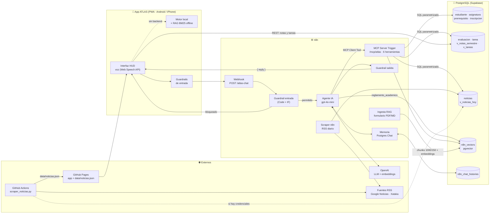

# Arquitectura de ATLAS

ATLAS es un modelo en n8n que apoya al estudiante de Ingeniería de Sistemas en la matrícula, el estado académico, la proyección y los requisitos, con recomendaciones para la investigación, el autoaprendizaje y la educación de precisión. Tiene siete componentes:

| # | Componente | Tecnología | Dónde está |
|---|---|---|---|
| 1 | Orquestador | **n8n** (4 flujos) | [`backend/n8n_*.json`](../backend) |
| 2 | Base de datos | **PostgreSQL** (Supabase) + pgvector | [`backend/schema.sql`](../backend/schema.sql) |
| 3 | Agente / LLM | Agente de n8n + **OpenAI gpt-4o-mini** + memoria en PostgreSQL | `n8n_atlas_chat.json` |
| 4 | RAG | Embeddings `text-embedding-3-small` + **pgvector**; corpus en [`rag/docs`](../rag/docs) | `n8n_atlas_ingesta_rag.json`, [`docs/RAG.md`](RAG.md) |
| 5 | Servidor MCP | **MCP Server Trigger** de n8n + servidor MCP en Python | `n8n_atlas_mcp_server.json`, [`mcp-server/`](../mcp-server) |
| 6 | App móvil | **PWA** instalable en Android e iPhone (voz, notas, tareas, noticias) | [`index.html`](../index.html), [`docs/ANDROID.md`](ANDROID.md) |
| 7 | Scraper | **GitHub Actions** diario (Python) + flujo de n8n equivalente | [`scraper/`](../scraper), `n8n_atlas_scraper_noticias.json` |

## Diagrama de componentes y flujos de datos



## Secuencia de una consulta

```mermaid
sequenceDiagram
  actor E as Estudiante
  participant A as App ATLAS
  participant W as n8n · Webhook
  participant G as Guardrails
  participant AG as Agente (LLM)
  participant M as Servidor MCP
  participant R as RAG (pgvector)
  participant P as PostgreSQL

  E->>A: 🎙 "¿Puedo habilitar Cálculo integral?"
  A->>A: voz → texto · guardrail local
  A->>W: POST {sessionId, studentId, message, context}
  W->>G: validar entrada (inyección, datos sensibles, trampa…)
  G->>P: fn_contexto_estudiante(codigo)
  G->>AG: mensaje + contexto
  AG->>R: reglamento_academico("habilitar")
  R-->>AG: Arts. 47 y 48 (2,5 mínimo; 60 % / 40 %)
  AG->>M: consultar_notas_semestre(20221045)
  M->>P: SELECT fn_notas_semestre($1)
  P-->>M: Cálculo integral · 2,97 · necesita 3,05
  M-->>AG: JSON
  AG-->>G: respuesta
  G-->>W: revisar salida (fuga de prompt, escala 0–5, longitud)
  W-->>A: { reply, guardrails }
  A-->>E: 🔊 respuesta por voz + texto
```

## Decisiones de diseño y su justificación

| Decisión | Alternativas consideradas | Por qué |
|---|---|---|
| **n8n como orquestador** | Código propio en Python/Node | Lo exige el trabajo. Además deja ver el flujo (webhook → guardrails → agente → respuesta), trae nodos nativos de agente, memoria, pgvector y MCP, y cada ejecución queda registrada como evidencia. |
| **PostgreSQL en Supabase** | MySQL, Firebase | Es relacional, que es lo que necesitan el plan de estudios, los prerrequisitos y las notas. **pgvector** guarda el RAG en la misma base de datos, Supabase expone una API REST automática (la usan la app, el scraper y el servidor MCP) y tiene un plan gratuito. |
| **Lógica académica en SQL** (`fn_contexto_estudiante`, `fn_notas_semestre`, `fn_tareas`, `fn_prerrequisitos`, vistas) | Calcular todo en el agente | Los números (nota necesaria, estado, PGA) los calcula la base de datos de forma determinista, y el LLM solo los explica. Así se evita que la IA invente cifras. |
| **Agente con herramientas (MCP) en lugar de un prompt gigante** | Pasar toda la base de datos al prompt | El agente pide solo lo que necesita. MCP es un estándar: las mismas herramientas sirven para n8n, Claude Desktop o MCP Inspector. |
| **RAG con fragmentos de 1.000 caracteres y 150 de solapamiento** | 500/50, 2.000/200 | Un artículo del reglamento ocupa entre 400 y 1.200 caracteres. Con 1.000 cada fragmento cubre una norma completa, y el solapamiento del 15 % evita cortar una regla entre dos fragmentos (ver [RAG.md](RAG.md)). |
| **`text-embedding-3-small`** | `text-embedding-3-large`, modelos locales | Es multilingüe y funciona bien en español. Con 1.536 dimensiones cabe en pgvector y su costo es mínimo para un corpus pequeño. |
| **gpt-4o-mini, temperatura 0,3** | gpt-4o, temperatura alta | Es rápido (importa para la voz) y económico. Una temperatura baja da respuestas consistentes con los datos. |
| **Guardrails en dos capas** (app + n8n) y **SQL parametrizado** | Confiar solo en el prompt | Se bloquean la inyección de prompt, los datos sensibles, el lenguaje ofensivo y las solicitudes de trampa antes de llegar al LLM. A la salida se revisan fugas del prompt y notas fuera de la escala. Los parámetros `$1, $2` eliminan la inyección SQL. |
| **PWA** como app móvil | App nativa Kotlin/Swift | Un solo código sirve para Android e iPhone. Se instala desde el navegador y funciona sin conexión gracias al service worker. Si se necesita un APK se genera con PWABuilder (ver [ANDROID.md](ANDROID.md)). |
| **Motor local + RAG BM25 en la app** | Depender siempre del backend | La demo funciona aunque falle internet o n8n, y los fallos degradan con elegancia: n8n → IA directa → motor local. |
| **Scraper en GitHub Actions** además del flujo de n8n | Solo n8n | Corre todos los días gratis y sin servidor, y cada ejecución deja un registro público como evidencia. Publica `data/noticias.json` en el mismo origen de la app, sin problemas de CORS. |
| **Reglamento UNAB aplicado al cálculo** | Redondeo estándar | El Art. 39 exige expresar la definitiva sin aproximar (2,96 queda en 2,9). Además se aplican la habilitación (Art. 47, mínimo 2,5; Art. 48, 60/40) y los estados por PGA (Arts. 10–12 y 67). |
