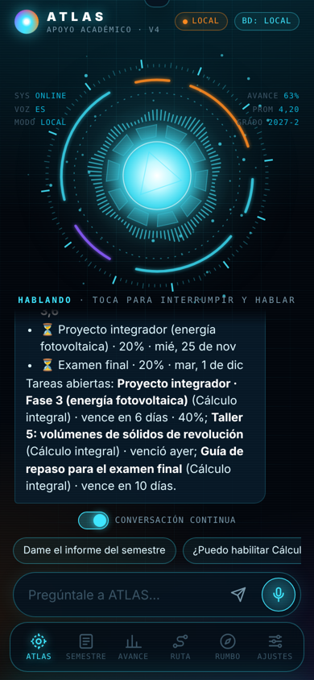
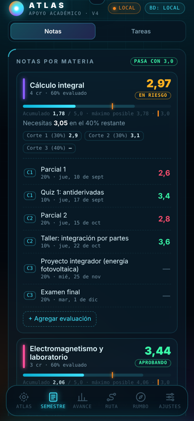
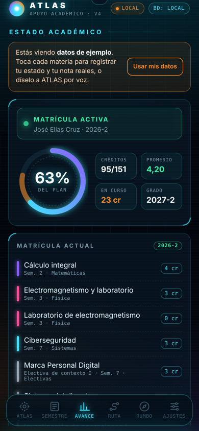
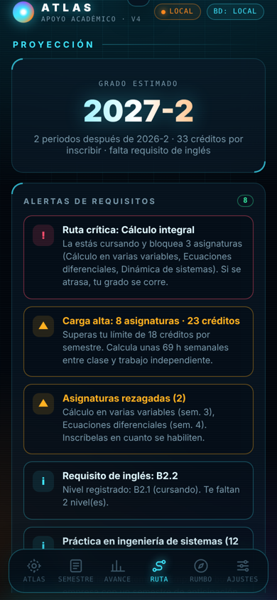
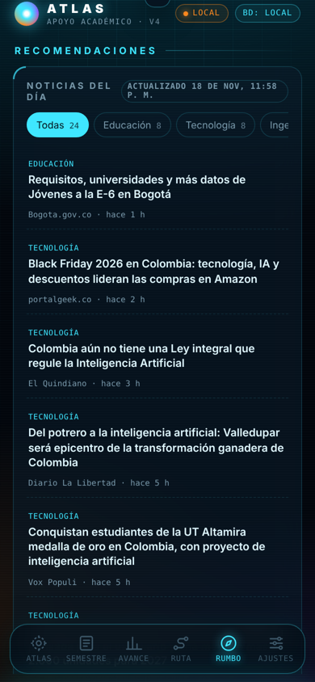

# Manual de usuario de ATLAS

ATLAS es tu asistente académico por voz. Sabe cómo vas en cada materia, qué tareas tienes pendientes, cuándo te gradúas, qué dice el reglamento y qué hacer para mejorar.

**Abrir la app:** https://elias2111.github.io/atlas-chatbot-academico/

## 1. Instalación

| Dispositivo | Pasos |
|---|---|
| **Android** (Chrome) | Abre el enlace, toca el menú ⋮ y luego **Instalar app** (o *Agregar a pantalla principal*). Si prefieres un APK, consulta [ANDROID.md](ANDROID.md). |
| **iPhone** (Safari) | Abre el enlace, toca **Compartir** y luego **Agregar a pantalla de inicio**. |
| **Computador** | Ábrelo en Chrome o Edge (sin VPN, para que funcione la voz). |

La primera vez toca **INICIAR SISTEMA**. Así se activa el audio y ATLAS te saluda con un resumen: avance, entregas de la semana y materias en riesgo.

## 2. Pantallas

| Pestaña | Qué ves | Captura |
|---|---|---|
| **ATLAS** | El núcleo de voz, el chat y las preguntas rápidas |  |
| **Semestre** | Notas por materia y por corte, la nota que necesitas para 3,0, el estado (aprobando, en riesgo, asegurada, perdida) y las tareas (por hacer, incompletas, vencidas, entregadas) |  |
| **Avance** | % del plan de 151 créditos, PGA, matrícula actual, el plan por semestres y tu rendimiento por área |  |
| **Ruta** | Fecha estimada de grado, semestres que faltan y alertas de requisitos |  |
| **Rumbo** | Noticias del día, plan semanal de estudio y recomendaciones de precisión, investigación y autoaprendizaje con sus fuentes |  |
| **Ajustes** | Tu perfil, la voz, la conexión a n8n, la IA directa y la base de datos | |

## 3. Hablar con ATLAS

1. Toca el **núcleo** (o el botón 🎙). Cuando cambia a violeta, te está escuchando.
2. Habla y haz una pausa: ATLAS responde en pantalla y en voz alta.
3. Si tocas el núcleo mientras habla, lo interrumpes y te escucha de inmediato.
4. Con **Conversación continua** activada, vuelve a escucharte cuando termina de hablar.

¿No te escucha? Revisa el permiso del micrófono (en iPhone: Ajustes → Siri → Dictado) o usa **Ajustes → Probar micrófono**. Siempre puedes escribir en la caja de texto.

### Qué le puedes preguntar

| Tema | Ejemplos |
|---|---|
| Semestre y notas | "Dame el informe del semestre" · "¿Cómo voy en Cálculo integral?" · "¿Aprobé Ciberseguridad?" · "¿Cuánto saqué en el parcial 2 de Cálculo integral?" · "¿Cuánto necesito para pasar Investigación de operaciones?" |
| Tareas | "¿Qué tareas tengo pendientes?" · "¿Tengo tareas vencidas?" · "¿Qué tengo para esta semana?" · "¿Qué tareas tengo de Sistemas Inteligentes?" |
| Matrícula y avance | "¿Qué materias estoy viendo?" · "¿Cómo voy en el plan?" · "¿Cuál es mi promedio?" |
| Proyección y requisitos | "¿Cuándo me gradúo?" · "¿Qué debo inscribir el próximo semestre?" · "¿Qué requisitos tengo pendientes?" · "¿Puedo ver Dinámica de sistemas?" |
| Reglamento (RAG) | "¿Puedo habilitar Cálculo integral?" · "¿Qué dice el reglamento sobre los supletorios?" · "¿Cuántas veces puedo cancelar una materia?" · "¿Qué necesito para graduarme?" |
| Recomendaciones | "Dame recomendaciones" · "Arma mi plan semanal" · "¿Qué técnicas de estudio funcionan mejor?" |
| Noticias | "Noticias de tecnología de hoy" · "¿Qué noticias hay de educación?" |
| Temas de las materias* | "Explícame integración por partes" · "¿Qué es la ley de Faraday?" |

\* Las explicaciones de temas requieren la IA conectada (n8n o IA directa). Sin IA, ATLAS te muestra los temas de la materia.

## 4. Actualizar tus datos

Por voz o por texto:

| Dices | ATLAS hace |
|---|---|
| "Saqué 3,5 en el examen final de Electromagnetismo" | Registra la nota en esa evaluación y te dice si aprobaste |
| "Entregué el informe de Faraday" | Marca la tarea como entregada |
| "Voy en el 80 % del trabajo de inventarios" | Actualiza el avance de la tarea |
| "Aprobé Álgebra lineal con 4,0" | Actualiza tu expediente |
| "Estoy viendo Ecuaciones diferenciales" · "Cancelé…" | Cambia el estado de la materia |

O tocando: en **Semestre**, toca una evaluación para poner su nota y peso, o una tarea para cambiar su fecha, estado y avance. En **Avance**, toca cualquier materia del plan. Cuando una materia tiene todas sus notas, la definitiva pasa sola a tu expediente: **sin aproximar**, como manda el reglamento (2,96 queda en 2,9).

Para empezar con tus datos reales usa **Usar mis datos** o **Empezar en blanco** (Avance) y **Vaciar semestre** (Ajustes).

## 5. Conexiones (Ajustes)

| Opción | Para qué |
|---|---|
| **Conexión n8n** | Pega la URL del webhook: las preguntas pasan por el agente con RAG, MCP y guardrails |
| **IA directa** | Con una API key de OpenAI, ATLAS responde preguntas abiertas sin servidor |
| **Base de datos académica** | URL y *anon key* de Supabase: tus notas y tareas se guardan en PostgreSQL y se sincronizan solas |

Si nada está conectado, ATLAS funciona con su motor local y sin internet.

## 6. Seguridad y privacidad

- Tus datos, la API key y el expediente se guardan solo en tu teléfono, salvo que conectes Supabase.
- ATLAS rechaza solicitudes de trampa académica, intentos de cambiar sus reglas y mensajes con contraseñas o números de tarjeta.
- Exporta tu expediente (Avance → Exportar) para respaldarlo.
