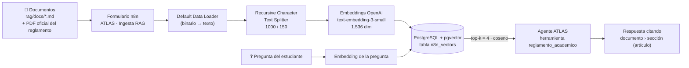

# RAG (Retrieval-Augmented Generation) en ATLAS

El RAG le da al agente la información que **no está en la base de datos relacional**: el reglamento estudiantil, el plan de estudios con sus prerrequisitos y la guía de éxito académico (técnicas de estudio con evidencia). Así el agente cita la norma o la fuente en lugar de inventarla.

## Pipeline



## Documentos usados

| Documento | Contenido | Origen |
|---|---|---|
| [`reglamento_unab_pregrado.md`](../rag/docs/reglamento_unab_pregrado.md) | Escala de notas, redondeo, PGA, estado condicional y prueba académica, supletorios, habilitaciones, validaciones, cancelaciones, asistencia, práctica y requisitos de grado, **con el número de artículo** | Reglamento Estudiantil de Pregrado UNAB 2019 ([PDF oficial](https://unab.edu.co/NewFolder/Reglamento-estudiantil-pregraod.pdf)) |
| [`plan_de_estudios_ingenieria_sistemas.md`](../rag/docs/plan_de_estudios_ingenieria_sistemas.md) | Las 51 asignaturas por semestre (151 créditos), prerrequisitos, lo que desbloquea cada una, rutas críticas y electivas | Plan de estudios oficial del programa |
| [`guia_exito_academico.md`](../rag/docs/guia_exito_academico.md) | Educación de precisión, cálculo de la nota necesaria, técnicas de estudio con evidencia, autoaprendizaje, investigación y carga académica, **con referencias** | Dunlosky et al. (2013), Roediger y Karpicke (2006), Yang (2021), Luan y Tsai (2021) |

Para la versión completa también se recomienda cargar el **PDF oficial del reglamento** en el formulario de ingesta (son unas 80 páginas). El resumen en Markdown garantiza que los artículos clave queden en fragmentos limpios.

## Parámetros y su justificación

| Parámetro | Valor | Justificación |
|---|---|---|
| Divisor | `RecursiveCharacterTextSplitter` (párrafo → viñeta → frase → palabra) | Respeta la estructura del documento: primero intenta cortar entre párrafos y solo si no alcanza, entre frases. Así no parte una norma a la mitad. |
| `chunk_size` | **1.000 caracteres** (~250 tokens) | Un artículo del reglamento ocupa entre 400 y 1.200 caracteres y una sección de la guía entre 600 y 1.000. Con 1.000, cada fragmento suele contener **una norma completa con su contexto**. Con fragmentos más pequeños (500) la regla queda separada de sus condiciones (por ejemplo, "habilitar" separado de "mínimo 2,5"). Con fragmentos más grandes (2.000) se mezclan temas y baja la precisión de la búsqueda. |
| `chunk_overlap` | **150 caracteres** (15 %) | Si una regla queda justo en el borde, sus primeras palabras aparecen en los dos fragmentos. El 10–20 % es el rango usual: menos pierde continuidad y más duplica contenido e infla el índice. |
| Modelo de embeddings | **`text-embedding-3-small`** (OpenAI, 1.536 dimensiones) | Es multilingüe y funciona muy bien en español. 1.536 dimensiones caben en pgvector con índice, y el costo es mínimo (el corpus completo cuesta menos de un centavo de dólar). `-large` (3.072 dimensiones) no aporta para un corpus de este tamaño. |
| Almacén | **pgvector** en la misma base de datos PostgreSQL | No hace falta un servicio más (Pinecone, etc.): las notas, el plan y los vectores quedan juntos y se respaldan juntos. |
| Recuperación | **similitud coseno, top-k = 4** | Cuatro fragmentos (~1.000 tokens) dan contexto suficiente sin saturar el prompt ni subir el costo por consulta. |
| Recuperador sin conexión (app) | **BM25** (k1 = 1,5; b = 0,75) con stemming ligero y expansión de sinónimos | Permite que la app responda preguntas del reglamento sin internet ni API key, con los **mismos fragmentos** que usa n8n. |

## Evidencia de recuperación

El script [`rag/rag_local.py`](../rag/rag_local.py) fragmenta los documentos con los mismos parámetros (1.000/150), construye el índice que usa la app ([`data/rag_index.json`](../data/rag_index.json), 35 fragmentos) y evalúa 12 consultas reales de estudiantes:

| Métrica | Resultado |
|---|---|
| Acierto en el primer resultado (precisión@1) | **10/12 = 83 %** |
| Acierto entre los 3 primeros (recall@3) | **12/12 = 100 %** |

El detalle de cada consulta y los fragmentos recuperados están en **[`rag/EVIDENCIA_RECUPERACION.md`](../rag/EVIDENCIA_RECUPERACION.md)**. Para reproducirlo:

```bash
python rag/rag_local.py eval                       # reconstruye el índice y reevalúa
python rag/rag_local.py ask "¿puedo habilitar con 2,6?"
```

Ejemplo dentro de la app ("¿Qué dice el reglamento sobre los supletorios?"):

> Quien no presenta una prueba por una justa causa puede pedir un examen supletorio una sola vez por prueba. La solicitud se hace dentro de los cinco días hábiles siguientes… 📚 *Fuente: Reglamento Estudiantil de Pregrado UNAB (2019) › Exámenes supletorios (Art. 45)*

## Cómo cargar los documentos en n8n

1. Importa y activa el flujo **ATLAS · Ingesta RAG** con las credenciales de Postgres y OpenAI.
2. Abre la URL del formulario (*Production URL* del nodo "Subir documento").
3. Sube, uno por uno, los tres `.md` de `rag/docs/` y el PDF oficial del reglamento.
4. Comprueba en Supabase: `SELECT count(*), metadata->>'source' FROM n8n_vectors GROUP BY 2;`
5. En el chat de n8n o en la app pregunta "¿Cuántas veces puedo cancelar una materia?". El agente debe llamar a `reglamento_academico` y citar el Art. 13. La herramienta usada se ve en el registro de la ejecución.
